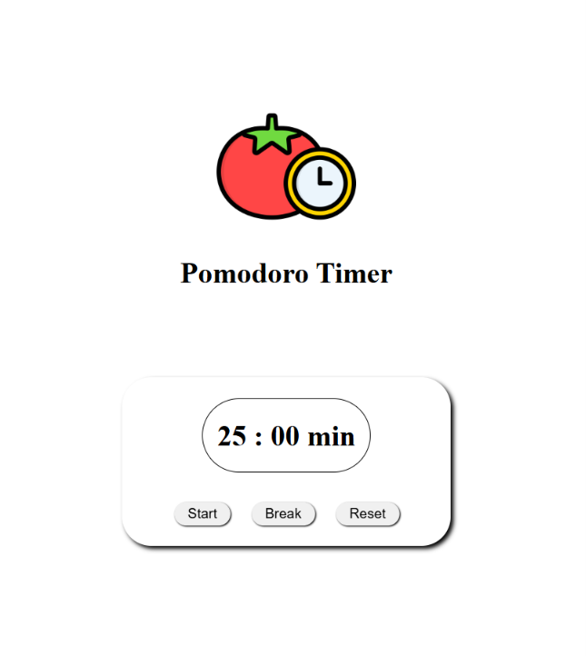

# Pomodoro Timer

A simple Pomodoro timer interface built with vanilla HTML, CSS, and JavaScript. The page displays a 25-minute focus session and provides **Start**, **Break**, and **Reset** controls.

> The current project is a visual prototype. Countdown and button behavior have not been implemented yet.

## Preview

## Setup

No dependencies, package installation, or build step are required.

1. Download or clone this project.
2. Open `index.html` in a web browser.

Alternatively, open the project folder in a code editor and use a local web server if you prefer to preview it that way.

## Project files

- `index.html` — page structure and timer controls.
- `style.css` — layout and visual styling.
- `script.js` — JavaScript entry point for timer behavior.
- `pomodoro-technique.png` — illustration shown above the timer.
- `screenshot.png` — screenshot of the interface.
