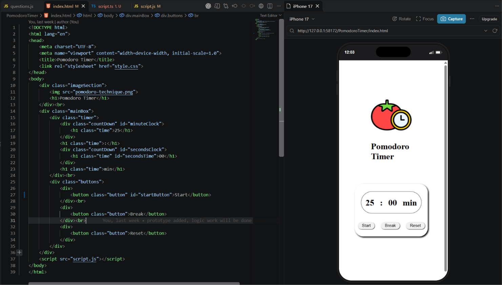

# Pomodoro Timer

A simple Pomodoro timer interface built with HTML, CSS, and **TypeScript** (compiled to JavaScript). The page displays a 25-minute focus session and provides **Start**, **Break**, and **Reset** controls.

## Preview

### iPhone 17 Preview



## What's New

- **TypeScript added** — Timer logic is now written in `script.ts` (TypeScript) and compiled to `script.js` for execution in the browser.
- **iPhone 17 preview checked** — The interface has been verified on an iPhone 17 viewport. Screenshot available in the `SSs-previews/` folder.

## Setup

No dependencies, package installation, or build step are required to run the app.

1. Download or clone this project.
2. Open `index.html` in a web browser.

Alternatively, open the project folder in a code editor and use a local web server if you prefer to preview it that way.

### Compiling TypeScript (optional)

If you edit `script.ts`, recompile it to `script.js` using the TypeScript compiler:

```bash
tsc script.ts
```

> Make sure you have TypeScript installed globally: `npm install -g typescript`

## Project files

- `index.html` — page structure and timer controls.
- `style.css` — layout and visual styling.
- `script.ts` — TypeScript source for timer behavior.
- `script.js` — compiled JavaScript output (do not edit directly).
- `SSs-previews/screenshot.png` — General view
- `SSs-previews/pomodoro-technique.png` — logo shown above the timer.
- `SSs-previews/mobileview.png` — additional mobile view screenshot.

### Author -

## Mohit Singh